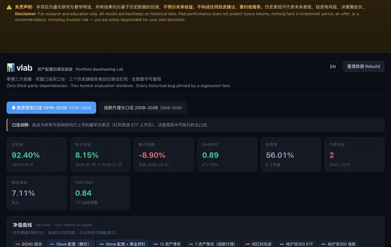

<div align="center">

# 📊 vlab — 资产配置回测实验室

### Zero-Dependency Portfolio Backtesting Lab

**诚实的回测实验室，而不是漂亮的回撤曲线。**

[](https://github.com/aazh2026/vlab/actions/workflows/ci.yml)
[](https://opensource.org/licenses/MIT)
[](https://www.python.org/)
[](https://pypi.org/)
[](https://postcodeengineering.com/vlab/)
[](https://github.com/aazh2026/vlab/releases/latest)
[](https://github.com/aazh2026/vlab/actions/workflows/ci.yml)
[](https://github.com/aazh2026/vlab/commits/main)
[](https://github.com/aazh2026/vlab/discussions)

<p align="center">
  
</p>

<p align="center"><sub>18 秒看完整面板：双窗口切换 → 8 个 KPI → 净值/回撤/年度收益 → 可排序绩效表。<br/>18-second tour: dual windows, 8 KPIs, equity &amp; drawdown curves, yearly returns, sortable performance table.</sub></p>

[English](#english) · [中文](#中文)

<p align="center">
  <a href="https://github.com/aazh2026/vlab/stargazers"></a>
  <a href="https://github.com/aazh2026/vlab/issues/new?template=bug_report.yml"></a>
  <a href="https://github.com/aazh2026/vlab/discussions"></a>
</p>

<p align="center"><sub>
如果这个仓库帮你避免了一次"被自己的回测 bug 骗了"，点个 ⭐ 是最直接的反馈 —— 它会决定我先修哪个 bug、先做哪个功能。<br/>
If this repo saved you from a silently broken backtest, a ⭐ is the most direct signal I can get — it decides which bug I fix first.
</sub></p>

</div>

---

## ⚠️ 免责声明 / Disclaimer

> **本项目为量化研究与教学用途。所有结果均为基于历史数据的回测，不预示未来收益，不构成任何投资建议、要约或推荐。历史表现不代表未来表现。投资有风险，决策需自负。**
>
> *For research and education only. All results are backtests on historical data. Past performance does not predict future returns, and nothing here is investment advice, an offer, or a recommendation. Investing involves risk — you are solely responsible for your own decisions.*

---

## 👀 谁该收藏这个仓库 / Who should star this

如果你符合下面**任意一条**，这个仓库对你有直接价值：

- **你写过自己的回测脚本** —— 这里的 93 个回归测试就是一份「常见坑清单」，可以直接拿去对照你的代码
- **你相信"回测数字"但不确定口径** —— 双窗口强制分离、不可投资部分留在现金、超额权重不归一化，这三条会改变你的结论
- **你在做资产配置 / 组合管理** —— 面板里 26 条策略曲线 + 可排序绩效表 + 年度收益链式还原，复制粘贴就能当内部看板
- **你在评估要不要自己写个回测引擎** —— 别写。这个仓库是纯标准库、零依赖、可以直接 `git clone` 跑起来的
- **你关心"回测软件的 bug 率"** —— 这个项目的 bug 清单和修复过程本身就是一份公开的案例研究
- **你在做参数网格搜索 / 因子筛选** —— `overfit gap` 直接告诉你「样本内挑出来的最好」有多少是运气；`oracle_oos` 是那个你本可以拿到、但没拿到的上界
- **你担心自己的策略偷看了未来** —— 护栏让 `mat[c][i+1]` 直接抛错，而不是安静地返回未来价格

**如果你只想看一个数字**：这套配置的价值是**把回撤压到约 −10%**，代价是每年少约 5.7 个百分点收益。它不是"更好的赚钱方法"，是"活下来的方法"。

---

## 这个项目在解决什么问题 / The problem

大多数"资产配置回测"的坑不在代码里，而在**口径**里。

我做了这个项目，起因是发现自己报出去的数字**被自己的引擎 bug 改过**，而且我事先完全不知道：

| 我最初报的数字 | 修复后的真实数字 | 差异 |
|---|---|---|
| 年化 6.78%，最大回撤 -13% | 年化 7.85%，最大回撤 **-8.97%** | **回撤差了 4.03 个百分点** |
| "回测覆盖 2015–2026" | 实际用了 2001–2026 数据 | **穿越了时空** |

三个缺陷，每一个都足以让结论**完全反转**：

| 缺陷 | 后果 | 修复 |
|---|---|---|
| **跨市场休市日未对齐** | 休市日持仓被计为 0 → 测出 **-90% 回撤**、1618% 波动 | forward-fill 对齐 |
| **货币 ETF 收益蒸发** | 净值恒定 100、收益以份额派发 → "全现金"年化显示 **0%**（真实 1.67%） | 按 1.8% 年化合成 |
| **权重过度归一化** | 未上市资产的权重被挤到少数可交易资产 → 制造出虚假的 **-30% 单年跌幅** | 超额权重留在现金 |

**这些 bug 现在每一个都有专门的回归测试钉死**（`tests/test_regressions.py` + `tests/test_property.py`，**93 个测试**，0.4 秒跑完）。

这不是"顺手加的测试"，这是这个项目**最有价值的资产**。因为如果这些测试不存在，下一个人随时可能把它们改回去，而你永远不会知道。

还有第 4 个问题，是**口径**而非代码：**窗口偏差**。用后来才上市的 ETF 从 2001 年开始回测，等于让未来的资产提前入场。所以本项目强制区分两个窗口：

- **窗口 A｜投资现实口径（2019-01-18 ~ 2026-11-25）** — 起点是所有可投标的均已上市的最早交易日。这是现实中能执行的口径，**对外结论的主口径**。
- **窗口 B｜指数代理长口径（2008-07-01 ~ 2026-11-25）** — 用中证红利等**指数**代理早期尚不存在的 ETF，覆盖 2008 金融危机。用于回答"这套配置在极端行情里到底扛不扛得住"。

**两个窗口的结论必须分开陈述，混用即为误导。**

---

## 📖 我从这个项目里学到的最重要的一件事

这个项目最有价值的部分，不是代码，是**一次失败**。

我原本只是想做一个自己的资产配置回测面板 —— 知道自己想配哪些资产，想知道"这么配到底行不行"。很自然地写了个回测脚本，跑出来一条漂亮的净值曲线，然后给自己报了个数字：

> *年化 6.78%，最大回撤 -13%。*

然后我意识到，**我不知道这个数字是不是真的**。

于是我把这个"脚本"重构成了一个正经的系统：真实的行情源、跨市场对齐、交易成本、双窗口、指标校验。然后写了回归测试。然后……测试立刻抓出了四个 bug。

| # | 缺陷 | 它让我的数字变成什么 | 真相 |
|---|---|---|---|
| 1 | 跨市场休市日未对齐 | 回撤 **-90%**、波动 1618% | A股和美股休市日不同，缺报价那天持仓被计成 0 |
| 2 | 货币 ETF 收益蒸发 | "全现金"年化 **0%** | 货币基金净值恒定 100，收益以份额派发，价格数据里根本看不到 |
| 3 | 权重过度归一化 | 2008 年单年 **-30%**（假的） | 我把权重归一到 1，未上市资产的钱被挤到少数能买的资产上 |
| 4 | 窗口偏差 | "回撤只有 -13%" | 从 2001 年开始回测，却用 2014 年才上市的 ETF —— 穿越了时空 |

第 4 条最阴险。它不是代码 bug，是**口径 bug** —— 代码完全正确，结论依然完全错误。

修复之后，同一套配置、同一个 2019–2026 窗口：

| | 我最初报的 | 修复后 | 差异 |
|---|---|---|---|
| 最大回撤 | **-13%** | **-8.97%** | **差 4.03 个百分点**（比例 1.45 倍） |
| 年化 | 6.78% | **7.85%** | 差 1.07 个百分点 |

> 注：`-13%` 与 `-8.97%` 的差是**百分点**不是"倍"。早期版本这里写成"回撤被低估了 4 倍"——**这正是本项目要消灭的那类单位混用错误**（把 4.03 个百分点说成了 4 倍），修正于此。

而如果我从来没建这个系统、从来没写那条测试，我会拿着 -13% 这个数字去做真实的投资决策，并且永远不会知道自己错了。

### 然后我又亲手制造了第 5 个 bug

重构到一半，我把 `_rebalance()` 拆成独立函数。里面写着：

```python
def _rebalance(cash, pos, ...):
    ...
    cash -= cost          # ← 这一行，什么都没改变
```

`cash` 是 float。Python **按值传递**。这行代码扣减的是一个函数内的副本，调用方的 `cash` 一分没少。

结果：**买入从不扣钱，权益凭空膨胀**。

我写的那条"现金策略年化应接近 1.8%"的测试，当场报错：

```
AssertionError: 23.65 not less than 0.025
```

**23.65%** —— 一个应该只有 1.8% 的现金策略，跑出了 13 倍。

如果测试没在那里，这会是我交付给你的"优化成果"。

### 这就是为什么这个仓库长这样

- 每个历史 bug 都有**一条专属回归测试**，注释里写清楚它曾经造成什么
- CI 在 Python 3.9–3.12 上跑同一套测试
- README 里明晃晃写着**这是回测，不是投资建议**

**回测系统的价值不在于它能算出多漂亮的曲线，而在于它会告诉你哪里算错了。**

---

## 真实结论 / What the backtest actually says

初始本金 100 万元，佣金 5bp + 滑点 3bp，月度调仓。

**窗口 A（2019–2026，可执行口径）**

| 策略 | 年化 | 最大回撤 | 夏普 | 期末净值 |
|---|---|---|---|---|
| 纯标普500 | **13.75%** | -33.90% | 0.64 | ¥2,934,283 |
| 纯黄金 ETF | 11.68% | -39.73% | 0.60 | ¥2,517,320 |
| 纯红利低波 | 11.35% | -16.53% | 0.60 | ¥2,456,330 |
| 12 资产等权 | 10.15% | -16.34% | **0.97** | ¥2,243,635 |
| **Steve 配置 + 黄金择时** | 8.15% | **-8.90%** | 0.89 | ¥1,924,031 |
| **Steve 配置（静态）** | 7.85% | **-8.97%** | 0.84 | ¥1,880,971 |
| 60/40 组合 | 6.63% | -10.47% | 0.57 | ¥1,709,619 |
| 纯沪深300 ETF | 4.93% | -44.64% | 0.16 | ¥1,494,993 |

**窗口 B（2008–2026，含金融危机）**

| 策略 | 年化 | 最大回撤 | 夏普 | 期末净值 |
|---|---|---|---|---|
| 纯标普500 | **10.56%** | -47.27% | 0.46 | ¥7,144,859 |
| 12 资产等权 | 7.83% | -16.34% | 0.77 | ¥4,375,060 |
| 7 资产等权（指数代理） | 5.18% | -32.16% | 0.30 | ¥2,691,229 |
| **Steve 配置 + 黄金择时** | 4.86% | **-9.39%** | 0.56 | ¥2,534,940 |
| **Steve 配置（静态）** | 4.77% | **-9.96%** | 0.54 | ¥2,490,449 |
| 纯沪深300 ETF | 5.47% | -52.89% | 0.17 | ¥2,840,483 |

### 结论说实话就是

**这套配置的价值是压回撤，不是提收益。**

- 窗口 B 跨 18 年含 2008 危机：Steve 配置回撤 **-9.96%**，同期纯沪深300 是 **-52.89%**、纯标普500 是 **-47.27%**
- 代价是年化少赚 **5.7 个百分点**（4.77% vs 10.56%）
- **黄金分档择时只小幅改善**（年化 +0.3pp），回撤几乎没变
- **MA200 趋势风控层无效**，对 2008 年回撤无任何改善

如果你要的是最高收益，这套配置是错的答案。如果你要的是"18 年不被打爆"，它可能是。

---

---

## 资产池 / Universe

想把自己的配置丢进来回测，需要知道标的代码。

| 代码 | 名称 | 类别 | 首个交易日 | 备注 |
|---|---|---|---|---|
| `sh511990` | 货币 ETF | 现金 | 2014-01-02 | 净值恒定 100，按 1.8% 年化合成 |
| `sh511010` | 国债 ETF | 债券 | 2014-01-02 | |
| `sh512890` | 红利低波 ETF | 红利 | **2019-01-18** | 决定窗口 A 起点 |
| `sh510880` | 红利 ETF | 红利 | 2014-01-02 | |
| `sh512800` | 银行 ETF | 红利 | 2017-08-03 | |
| `sh510300` | 沪深300 ETF | A股宽基 | 2014-01-02 | |
| `sh513100` | 纳指 ETF | 美股 | 2014-01-02 | |
| `sh518880` | 黄金 ETF | 黄金 | 2014-01-02 | |
| `usSPY.OQ` | 标普500 | 美股 | 2001-01-02 | 全收益近似（1.3%/年） |
| `usXLF.OQ` | 美股金融 | 红利 | 2001-01-02 | 全收益近似（2.2%/年） |
| `usQQQ.OQ` | 纳指100 | 美股 | 2001-01-02 | 全收益近似（0.6%/年） |
| `usAGG.OQ` | 美债 | 债券 | 2005-01-03 | 全收益近似（2.0%/年） |
| `usGLD.OQ` | 美股黄金 | 黄金 | 2004-11-18 | |
| `usSLV.OQ` | 白银 | 金属 | 2006-04-28 | |
| `usIWM.OQ` | 罗素2000 | 美股 | 2005-01-03 | 全收益近似（1.4%/年） |
| `usUUP.OQ` | 美元指数 | 汇率 | 2007-03-01 | |
| `ixsh000300` | 沪深300指数 | 指数 | 2005-04-08 | 长窗口代理 |
| `ixsh000922` | 中证红利 | 指数 | 2008-07-31 | 长窗口代理 |
| `ixsh000015` | 上证红利 | 指数 | 2014-01-02 | 长窗口代理 |
| `ixsh000905` | 中证500 | 指数 | 2014-01-02 | 长窗口代理 |

**代码命名规则**：`sh`/`sz` = A 股 ETF，`ix` = 指数，`us` = 美股（`.OQ` = 纳斯达克报价源）。

**想回测自己的配置？** 提一个 Issue，格式见 [Issue 模板](.github/ISSUE_TEMPLATE/strategy_request.yml)。
或者直接读 [CONTRIBUTING.md](CONTRIBUTING.md) 的「想加一个自己的策略」。

---

## 特性 / Features

- **零第三方依赖** — 核心只用 Python 标准库，`git clone` 就能跑
- **零 CDN 前端** — 面板是单个 HTML + 手写 SVG，断网也能打开
- **真实行情数据** — 腾讯 ifzq（A股/港股）+ 新浪（美股全历史），自动分页 + 本地缓存
- **完整绩效指标** — CAGR / Vol / Sharpe / Sortino / Calmar / 最大回撤区间定位 / 年度收益链式还原
- **双窗口诚实口径** — 强制区分"可执行"与"长周期代理"
- **回归测试钉死每个历史缺陷** — 93 个测试（策略 17 + 房产 35 + 有效性 25 + 沙盒 16），0.4 秒
- **交互式面板** — 13 策略同屏净值/回撤对比，图例可开关，表格可排序，中英双语
- **房产模块：持币 vs 持房** — 月供摊还、租金税费、空置损耗、买卖税费全建模；
  输出保本租金、保本房价年化、一次性跌幅，以及「房价 × 租金 × 利率」敏感性网格
- **防未来函数护栏** — 策略只能看到"截至当天"的数据；读 `mat[c][i+1]` 直接抛
  `LookAheadError`，把静默的作弊变成响亮的错误
- **自定义策略有效性检验** — 样本内/样本外切分、参数网格搜索（含 overfit gap
  与先知基线）、滚动前推；CLI 一条命令出报告
- **CI 覆盖 Python 3.9–3.12** + GitHub Pages 静态站

---

## 📖 延伸阅读

- **[回测数字最危险的地方：它看起来太像真的了](https://postcodeengineering.com/backtest-validity/)**
  — 四个能反转结论的引擎缺陷、防未来函数护栏、以及样本外有效性检验的实测。
  英文：[The most dangerous part of a backtest is that it looks too real](https://postcodeengineering.com/backtest-validity/)

---

## 快速开始 / Quick start

**方式一：从源码运行（无需安装，无需联网）**

```bash
git clone https://github.com/aazh2026/vlab.git
cd vlab

# 跑测试（无需安装依赖，无需联网）
python3 -m unittest discover -s tests -v

# 抓取行情数据（约 7MB，缓存到 data/）
PYTHONPATH=src python3 -m vlab fetch

# 生成回测报告
PYTHONPATH=src python3 -m vlab report

# 启动本地面板 → http://127.0.0.1:8765
PYTHONPATH=src python3 -m vlab serve
```

**方式二：Homebrew 安装（已上线可用，零依赖）**

```bash
brew tap aazh2026/vlab
brew install aazh2026/vlab/vlab

vlab test          # 跑 93 个回归测试
vlab fetch && vlab report && vlab serve
```

Formula 位于 [`aazh2026/homebrew-vlab`](https://github.com/aazh2026/homebrew-vlab)，当前追踪 **v1.1.1**。

**方式三：pip 安装（零依赖，Python 3.9+）**

包已构建并由 CI 校验（wheel + sdist、`dependencies = []`）。**PyPI 发布正在走流程中**，
在此之前可以直接从 GitHub Releases 装：

```bash
pip install https://github.com/aazh2026/vlab/releases/download/v1.1.1/vlab-1.1.1-py3-none-any.whl

vlab --help
vlab test          # 93 个回归测试
```

PyPI 上架后即为 `pip install vlab`。

> 三种方式产出的结果完全一致——引擎、指标、面板是同一份代码，
> 差别只在于是从 wheel 安装、从 brew 安装，还是从工作区运行。

**在线体验**：<https://postcodeengineering.com/vlab/>

---

## 作为库使用 / Use as a library

```python
from vlab import engine, strategies, windows

series = engine.load_series()
dates  = engine.trading_dates(series)
mat    = engine.align(series, dates)

# 切到"投资现实口径"
D, M = windows.slice_window(dates, mat, "A")

# 跑策略
res = engine.backtest(strategies.STRATEGIES["steve"].fn, M, D,
                       start_cash=1_000_000, fee_bps=5, slip_bps=3)
metrics = engine.metrics_of(res["curve"])
print(engine.fmt(metrics, "Steve"))
```

写自己的策略只需返回一个函数：

```python
def my_strategy(date, mat, dates, i):
    # 只能看到当日及之前的数据
    return {"sh512890": 0.5, "sh518880": 0.3, "sh511990": 0.2}
```

---

## 项目结构 / Layout

```
src/vlab/
  engine.py       回测引擎：权重归一化、成交、现金守恒
  metrics.py      指标计算：CAGR/Sharpe/Sortino/回撤区间/年度收益
  strategies.py   策略注册表
  windows.py      双窗口定义与切片
  datasource.py   多源行情抓取（腾讯 → 新浪 → Yahoo）
  report.py       报告构建（含免责声明、方法论、缺陷清单）
  property.py     房产模块：月供摊还、持币 vs 持房、敏感性网格
  guard.py        防未来函数护栏：策略只能读到 [0, i]
  validate.py     有效性检验：holdout / parameter_sweep / walk_forward
  web/            面板：server.py (标准库 HTTP) + index.html (自绘 SVG)
tests/
  test_regressions.py   三个历史缺陷 + 现金守恒 + 无未来信息
  test_property.py      摊还、盈亏平衡、敏感性网格
  test_validate.py      护栏拦截 + 样本外切分 + walk-forward
examples/
  momentum_rotation.py  可直接跑的自定义策略示例
scripts/
  build_site.py   构建 GitHub Pages 静态站（输出到 site/ 并同步到 docs/）
```

---

## 🧪 用你自己的策略做有效性检验

**能，而且这是本项目最该被用的方式。**

引擎本来就能跑任意策略（一个 `weights_fn` 函数即可）。但"跑出数字"不等于"数字有效"——
一个策略在样本内跑出 25% 年化，可能只是因为参数挑得刚好适合那段历史。

所以本项目提供三样东西，让"有效性"这个问题有答案：

### 1. 防未来函数护栏（`vlab.guard`）

引擎以前把**完整价格矩阵**交给策略函数，策略写 `mat[c][i+1]` 就能读到未来价格——
引擎不报错、回测照样跑完、结果照样漂亮。

这等于给一个专门消灭"回测欺骗"的项目留了后门。现在策略只拿得到截至当天的视图：

```python
from vlab import guard

def cheat(date, mat, dates, i):
    return {"sh510300": 1.0} if mat["sh510300"][i + 1] is not None else {}

engine.backtest(cheat, mat, dates)
# → vlab.guard.LookAheadError: 策略试图读取未来数据：索引 1 超出当前可见范围 [0, 0]
```

负索引（`mat[c][-1]`）同样按真实长度解析，所以也会被拦下。
**偷看未来从静默的作弊变成了响亮的错误。**

### 2. 三种有效性检验（`vlab.validate`）

| 检验 | 回答什么问题 |
|---|---|
| `holdout` | 单次样本内/样本外切分，看成绩衰减多少 |
| `parameter_sweep` | 参数网格搜索 + 样本外验证，给出 **overfit gap** |
| `walk_forward` | 滚动前推，每段用历史选参数、在没见过的下一段上检验 |

`parameter_sweep` 的关键输出是 **overfit gap** 和 **先知基线**：

- `selected_oos` —— 样本内最优参数到了样本外还剩多少
- `oracle_oos` —— **直接用样本外最优参数**能拿多少（搜索偏差的上界）
- `overfit_gap = selected_oos − oracle_oos`

**差距越大，"样本内挑出来的最好"就越可能只是运气。**

实测一个动量轮动策略（lookback 20/60/120 三组参数）：

```
样本内最优 lookback=60  →  样本外夏普 0.341
先知基线 lookback=20    →  样本外夏普 0.518
overfit gap             =  0.177
```

样本内最"好"的那组，在样本外反而不如另一组 —— 这正是这个模块存在的意义。

### 3. 命令行入口

```bash
# 你的策略文件只需定义 weights_fn(date, mat, dates, index)
PYTHONPATH=src python3 -m vlab validate examples/momentum_rotation.py
```

输出全样本、窗口 A/B、以及样本内/样本外对比与衰减幅度：

```
=== 全样本 ===
  全样本: 年化 6.40%  回撤 -52.05%  夏普 0.29  交易日 6686
  窗口 A: 年化 7.52%  回撤 -26.54%  夏普 0.45  交易日 2039
  窗口 B: 年化 8.71%  回撤 -42.10%  夏普 0.44  交易日 4779

=== 样本外检验（切分日 2019-03-06）===
  样本内: 年化 6.52%  回撤 -52.05%  夏普 0.28
  样本外: 年化 6.10%  回撤 -26.54%  夏普 0.34
  年化衰减：-0.42 pp    夏普衰减：+0.07
```

示例见 `examples/momentum_rotation.py`。

### 诚实说明

- **预热期**：策略只能看到当前日及之前。需要回看窗口的策略（如 60 日动量），
  `validate` 会在**完整历史上运行**再切分指标，预热天然可用。
- **样本外不重置资金**：连续运行后取子集，保留真实路径依赖。
- **walk-forward 是等权拼接**：每段起点归一为 1.0，衡量的是策略本身，
  不是一个连续账户的资金曲线。
- 检验只回答"这段历史里有效吗"，**不回答"未来会有效吗"**。

---

## 🏠 持币 vs 持房 · 上海田林十一村

这个项目最初是为回答一个具体问题而写的：**同一笔钱，买房和拿在手里买理财，哪个更划算？**

面板底部现在有完整的房产模块（`src/vlab/property.py`），把这件事算清楚了：

**建模了什么**

- 等额本息月供（逐月摊还，末期精确归零）
- 租金收入、**出租税费**（房产税等 4%）、**空置与维修损耗**（5%）、物业费
- 买入端：契税、中介费、登记杂费；卖出端税费
- 房价按**月复利**路径外推，不是简单年化

**两种持币情景可切换**

- 货币基金 1.8% 年化（基准，容易核验）
- Steve 配置的**历史月收益率均值外推** —— 明确标注为外推，不是预测

**输出三个盈亏平衡点**

| 指标 | 含义 |
|---|---|
| 保本月租金 | 持房要持平，租金得涨到多少 |
| 保本房价年化涨幅 | 房价年化涨幅低于多少就持平 |
| 一次性跌幅 | 房价一次性跌多少才持平 |

**以及一个敏感性网格**（房价 × 租金 × 利率，5×5×3）

结论只在**整个网格符号一致**时才算稳健。否则面板直接标注「结论不稳健」。

### 当前占位假设下的结论（说实话版）

以 60 m²、单价 9 万/m²、月租 6000、首付 35%、房贷 3.0%/30 年、房价年化 +2% 计算：

- 毛租金回报 **1.33%**，扣税费与空置后净回报 **1.22%**，房贷利率 3.0% → **carry −1.78%**（负 carry）
- 3 年后：持币终值约 219 万，持房终值约 210 万，**差额约 −9.6 万**
- 换成 Steve 配置外推：持币终值约 267 万，差额扩大到 **约 −57 万**
- 敏感性网格 **75 格里只有 6 格持房占优** → **结论不稳健，会随假设翻转**
- 保本条件：月租要涨到约 **8.9 千**，或房价年化涨幅降到约 **2.6%** 以下

**换句话说：以这组假设，租房+理财在 3 年尺度上占优，而且优势不算大、也不稳健。**

### ⚠️ 这组数字不能直接拿去决策

**本模块不接入任何房产挂牌或成交数据。** 挂牌价是卖方报价，不是成交价 —— 用它算收益是最常见的自欺。

真实决策需要你**自己核验并填入**：

- 近 6 个月**网签成交**价（同小区、同面积段）
- **银行预审**给出的实际可贷额度与利率
- **税费**核定（契税、增值税及附加、个税、中介费）
- **贷款**预审批结果（房龄是否影响年限与成数）

这些数字全部在 `src/vlab/property.py` 的 `ASSUMPTIONS` 里，改完重跑 `python3 -m vlab report` 即可。
模块提供的是**计算框架与敏感性分析**，不是对市场的预测。

---

## 已知局限 / Known limitations

诚实清单，面板里也有：

| 项 | 说明 |
|---|---|
| **美股为全收益近似** | 按固定年化分红率调整原始价格，非精确股息再投资，会略微高估美股长周期收益 |
| **成交价取调仓日收盘价** | 不含日内择时能力，未建模开盘/收盘价差之外的市场冲击 |
| **黄金分档择时收益有限** | 年化仅 +0.3pp，回撤改善不明显；复杂度可能不划算 |
| **MA200 趋势层已验证无效** | 保留在代码中仅作对照，建议实际使用中移除 |
| **网格搜索最优解过拟合** | 样本外衰减 -0.45，该结论已弃用 |
| **ETF 早期历史依赖指数代理** | 窗口 B 用指数代替尚未上市的 ETF，属代理而非真实可投 |
| **不含税费** | A 股红利税、基金赎回费、股息预扣税均未建模 |
| **闲置现金默认不计息** | 引擎默认 `cash_apy=0`（保守口径）。面板曾显示"按货币基金计息"却从未计息 —— 该谎话已删除，改为显式的"闲置现金年化利率"输入框（默认 0%），并在结果里如实披露利息金额 |
| **美股未做汇率换算** | 美元价格与人民币价格被当作同一"元"直接相加。Steve 配置含 15% 美股权重，人民币升值/贬值会系统性地高估/低估这部分收益 —— **这是当前最大的单一未修偏差** |

> 汇率缺失的实测影响方向：2019-01 → 2026-11 期间 USDCNY 从约 6.75 升至约 7.1，
> 美元资产的人民币计价收益被低估约 5%。修复前，所有含美股权重的结论都应视为
> **保守**（偏向低估），但这是"碰巧"而非"设计"，不得依赖。

---

## 贡献 / Contributing

见 [CONTRIBUTING.md](CONTRIBUTING.md)。核心要求只有一条：

> **宁可让一个结论被推翻，也不要让一个错误结论留在报告里。**

任何改动引擎行为的 PR，都必须同时更新回归测试，并说明这个改动影响了哪些已有结论。

---

## License

MIT © 2026 [aazh2026](https://github.com/aazh2026)

---

# English

## ⚠️ Disclaimer

> **For research and education only. All results are backtests on historical data. Past performance does not predict future returns, and nothing here constitutes investment advice, an offer, or a recommendation. Investing involves risk — you are solely responsible for your own decisions.**

## 👀 Who should star this

If **any** of these apply, this repo is directly useful to you:

- **You have written your own backtest script** — the 93 regression tests are effectively a checklist of the traps, and you can diff your code against it
- **You believe the numbers but not the methodology** — dual windows that must never be mixed, uninvestable weight left in cash, no silent renormalisation: each of those can change your conclusion
- **You work on allocation or portfolio management** — 26 strategy curves, a sortable performance table, and chained yearly returns you can lift straight into an internal dashboard
- **You were about to write your own backtest engine** — don't. Pure standard library, zero dependencies, `git clone` and run
- **You care about how buggy backtest software tends to be** — the bug list and the fixes are a public case study
- **You run parameter sweeps or screen factors** — `overfit gap` tells you how much of your "best in-sample" result was luck; `oracle_oos` is the upper bound you didn't capture
- **You worry your strategy peeked at the future** — the guard makes `mat[c][i+1]` raise instead of silently returning a future price

**If you only read one number**: this allocation's job is to hold drawdown near **−10%**, and the price is about **5.7 percentage points of annual return**. It is not a better way to make money; it is a way to survive.

---

## What this is

A zero-dependency backtesting lab for a multi-asset allocation, built around one idea: **honesty beats a pretty equity curve.**

Three engine bugs were found and fixed during development. Each one was severe enough to *invert* the conclusions:

| Bug | Impact | Fix |
|---|---|---|
| Cross-market holidays not aligned | -90% drawdown, 1618% volatility | forward-fill alignment |
| Money-market yield evaporated | "All cash" showed 0% CAGR | synthesize 1.8% APY |
| Weights over-normalised | fake -30% year in 2008 | leave excess weight in cash |

Every one of them now has a dedicated regression test. That test suite is the most valuable artifact in this repo.

The project also enforces **two separate evaluation windows** so that results are never mixed misleadingly:

- **Window A (2019-01-18 → 2026-11-25)** — "Investable Reality": starts when every tradable asset already exists. This is the primary, executable measure.
- **Window B (2008-07-01 → 2026-11-25)** — "Index-Proxy Long Window": uses indices to stand in for ETFs that did not exist yet, so the 2008 crisis is covered.

## Headline result

**This allocation's value is drawdown control, not return maximisation.**

Across an 18-year window containing the 2008 crisis, the tested allocation holds drawdown to **-9.96%**, versus **-52.89%** for the CSI 300 ETF and **-47.27%** for the S&P 500. The price is **5.7 percentage points of annual return** (4.77% vs 10.56%).

Two honest negatives are documented rather than hidden: the gold-banding overlay adds only ~0.3pp of CAGR, and the MA200 trend-risk layer measurably does nothing.

## Cash vs house

The project was originally built to answer one question: **for the same money, is buying a flat better than holding assets?**

`src/vlab/property.py` models it: equal-principal-and-interest amortisation, rent tax, vacancy, management fees, buy and sell costs, and a monthly-compounded price path. It reports the break-even rent, the break-even price growth, the one-off price drop that would make holding break even, and a price × rent × rate sensitivity grid. A conclusion only counts as robust when the entire grid has one sign.

**It ingests no listing or transaction data.** Asking prices are not transaction prices, and loan terms and taxes must come from bank pre-approval and registered contracts. The module gives you a calculation framework and a sensitivity analysis — not a prediction.

## Quick start

```bash
python3 -m unittest discover -s tests -v      # 93 tests, no deps, no network
PYTHONPATH=src python3 -m vlab fetch          # download quotes (~7MB, cached)
PYTHONPATH=src python3 -m vlab report         # build the report
PYTHONPATH=src python3 -m vlab serve          # dashboard on :8765
```

Live demo: <https://postcodeengineering.com/vlab/>

## Further reading

- **[The most dangerous part of a backtest is that it looks too real](https://postcodeengineering.com/backtest-validity/)**
  — the four engine bugs that each inverted the conclusion, the look-ahead guard,
  and a measured out-of-sample validity check.

## License

MIT © 2026 aazh2026
